<div align="center">

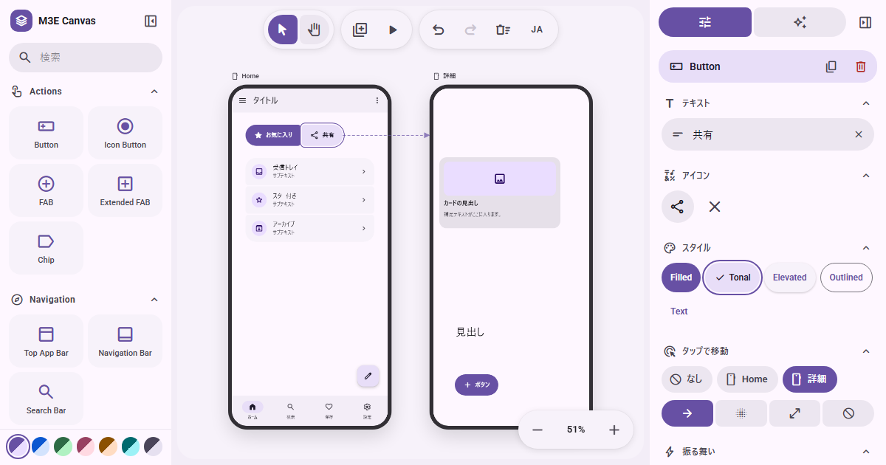

<br><br>

<p align="center">
<a href="https://smartworldarafath.github.io/Material-3-Expressive-Screen-UI/"><picture><source media="(prefers-color-scheme: dark)" srcset="assets/readme/dark/btn-launch.svg"></picture></a>
<a href="https://github.com/smartworldarafath/Material-3-Expressive-Screen-UI"><picture><source media="(prefers-color-scheme: dark)" srcset="assets/readme/dark/btn-github.svg"></picture></a>
<a href="#support"><picture><source media="(prefers-color-scheme: dark)" srcset="assets/readme/dark/btn-sponsor.svg"></picture></a>
<a href="#devices"><picture><source media="(prefers-color-scheme: dark)" srcset="assets/readme/dark/btn-fold.svg"></picture></a>
</p>

<p align="center">
<a href="#faq" title="100% Client-Side Privacy"><picture><source media="(prefers-color-scheme: dark)" srcset="assets/readme/dark/badge-clientonly.svg"></picture></a>
<a href="https://nextjs.org" target="_blank" rel="noopener noreferrer" title="Next.js 16 App Router"><picture><source media="(prefers-color-scheme: dark)" srcset="assets/readme/dark/badge-nextjs.svg"></picture></a>
<a href="https://react.dev" target="_blank" rel="noopener noreferrer" title="React 19 Declarative UI"><picture><source media="(prefers-color-scheme: dark)" srcset="assets/readme/dark/badge-react.svg"></picture></a>
<a href="https://m3.material.io" target="_blank" rel="noopener noreferrer" title="Google Material 3 Expressive"><picture><source media="(prefers-color-scheme: dark)" srcset="assets/readme/dark/badge-m3e.svg"></picture></a>
<a href="#devices" title="Xiaomi 18 Fold 3D Simulation"><picture><source media="(prefers-color-scheme: dark)" srcset="assets/readme/dark/badge-fold.svg"></picture></a>
<a href="#devices" title="Phone, Watch, Tablet, Fold & Desktop Ecosystem"><picture><source media="(prefers-color-scheme: dark)" srcset="assets/readme/dark/badge-devices.svg"></picture></a>
<a href="#overview" title="Zero Backend · 100% Client-Side Sandbox"><picture><source media="(prefers-color-scheme: dark)" srcset="assets/readme/dark/badge-zerobackend.svg"></picture></a>
<a href="LICENSE" title="MIT License (100% Free & Open Source)"><picture><source media="(prefers-color-scheme: dark)" srcset="assets/readme/dark/badge-mit.svg"></picture></a>
<a href="https://github.com/smartworldarafath/Material-3-Expressive-Screen-UI/pulls" title="Pull Requests Welcome!"><picture><source media="(prefers-color-scheme: dark)" srcset="assets/readme/dark/badge-prs.svg">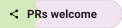</picture></a>
</p>

</div>

<h3 id="overview"><picture><source media="(prefers-color-scheme: dark) and (max-width: 640px)" srcset="assets/readme/dark/hm-overview.svg"><source media="(prefers-color-scheme: dark)" srcset="assets/readme/dark/h-overview.svg"><source media="(max-width: 640px)" srcset="assets/readme/light/hm-overview.svg">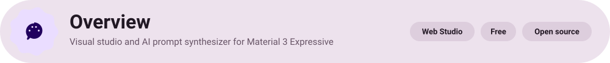</picture></h3>

**Material 3 Expressive Screen UI** is an open-source, browser-resident visual design canvas and AI prompt synthesizer engineered specifically for Google's **Material 3 Expressive (M3E)** design system.

You can construct rich user interfaces with drag-and-drop components, calibrate harmonious tonal schemes, simulate dual-screen foldable hardware like the **Xiaomi 18 Fold in true 3D**, and transform visual prototypes directly into deterministic, high-fidelity prompts ready for autonomous AI coding agents (**Claude Code**, **Cursor**, **Codex**, and **Gemini**).

There are no backend databases, zero telemetry, and no accounts required. Everything executes entirely inside your browser's local sandbox.

<p align="center">
  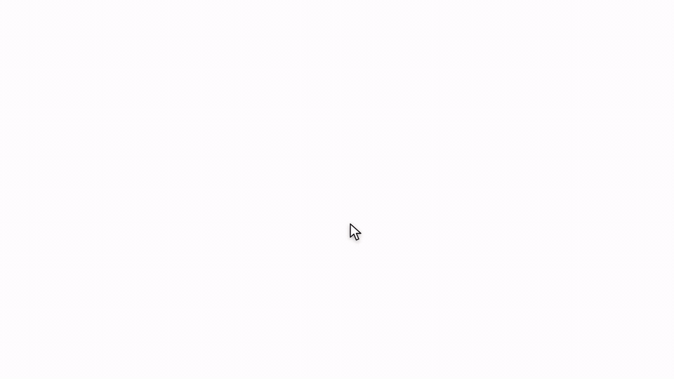
</p>

<p align="center"><sub>Construct an interface, calibrate dynamic color hues, simulate realistic 3D book folding, synthesize an AI prompt, and execute on Android or the Web. (<a href="docs/story.mp4">Watch HD Walkthrough Video</a>)</sub></p>

<table width="100%"><thead><tr><th align="left" width="28%">Quick facts</th><th align="left">Details</th></tr></thead><tbody>
<tr><td><b>App name</b></td><td>Material 3 Expressive Screen UI (M3E Canvas)</td></tr>
<tr><td><b>Live URL</b></td><td><a href="https://smartworldarafath.github.io/Material-3-Expressive-Screen-UI/">smartworldarafath.github.io/Material-3-Expressive-Screen-UI</a></td></tr>
<tr><td><b>Platform</b></td><td>Modern Web Browsers (Responsive Desktop & Mobile PWA)</td></tr>
<tr><td><b>Architecture</b></td><td>Next.js 16 (App Router) · React 19 · TypeScript 5.7</td></tr>
<tr><td><b>Design System</b></td><td>Google Material 3 Expressive (Shapes, springs, tonal palettes & morphing loaders)</td></tr>
<tr><td><b>Form Factors</b></td><td>📱 Phone (412×892) · 📖 Xiaomi 18 Fold (3D Dual Screen) · ⌚ Wear OS Watch · 📱 Tablet · 💻 Desktop</td></tr>
<tr><td><b>Physics Engine</b></td><td>Framer Motion 12 physics-based spring simulations, gesture drag, and 3D folding transforms</td></tr>
<tr><td><b>AI Prompting</b></td><td>Structured deterministic prompt generation for Jetpack Compose, Flutter, and React/Tailwind</td></tr>
<tr><td><b>Privacy</b></td><td>100% Client-Side · Zero telemetry · Local storage persistence and LZ-String stateless sharing</td></tr>
<tr><td><b>License</b></td><td>MIT License (100% Free & Open Source)</td></tr>
</tbody></table>

<div align="center">

| Action | Link |
|:---|:---|
| **🚀 Open Live Studio** | [smartworldarafath.github.io/Material-3-Expressive-Screen-UI](https://smartworldarafath.github.io/Material-3-Expressive-Screen-UI/) |
| **⭐ GitHub Repository** | [smartworldarafath/Material-3-Expressive-Screen-UI](https://github.com/smartworldarafath/Material-3-Expressive-Screen-UI) |
| **💬 Report an Issue** | [GitHub Issues Tracker](https://github.com/smartworldarafath/Material-3-Expressive-Screen-UI/issues) |
| **🤝 Contribute** | [GitHub Pull Requests](https://github.com/smartworldarafath/Material-3-Expressive-Screen-UI/pulls) |
| **💖 Support / Donate** | [SupportKori](https://www.supportkori.com/arafathrahman) · [GitHub Sponsors](https://github.com/sponsors/smartworldarafath) · [nsave / RedotPay](#support) |
| **⚖️ License** | [MIT License](LICENSE) |

</div>

<div align="center">

<a href="https://github.com/smartworldarafath/Material-3-Expressive-Screen-UI/issues"><picture><source media="(prefers-color-scheme: dark)" srcset="assets/readme/dark/btn-issues.svg">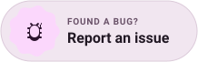</picture></a>
<a href="https://github.com/smartworldarafath/Material-3-Expressive-Screen-UI/pulls"><picture><source media="(prefers-color-scheme: dark)" srcset="assets/readme/dark/btn-contribute.svg"></picture></a>
<a href="LICENSE"><picture><source media="(prefers-color-scheme: dark)" srcset="assets/readme/dark/btn-license.svg">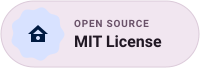</picture></a>

</div>

<h3 id="devices"><picture><source media="(prefers-color-scheme: dark) and (max-width: 640px)" srcset="assets/readme/dark/hm-devices.svg"><source media="(prefers-color-scheme: dark)" srcset="assets/readme/dark/h-devices.svg"><source media="(max-width: 640px)" srcset="assets/readme/light/hm-devices.svg"></picture></h3>

Material 3 Expressive Screen UI supports multi-device design natively across five distinct form factors:

<table width="100%"><thead><tr><th align="left" width="24%">Form Factor</th><th align="left" width="22%">Resolution</th><th align="left">Capabilities & Design Behavior</th></tr></thead><tbody>
<tr><td><b>📱 Phone</b></td><td>412 × 892 dp (9:19.5)</td><td>Default Android portrait viewport with system status bar, bottom pill bar, expandable FABs, and modal sheets.</td></tr>
<tr><td><b>📖 Xiaomi 18 Fold</b></td><td>780 × 892 dp (Unfolded)<br>412 × 892 dp (Cover)</td><td><b>True 3D Book-Folding Perspective</b> (0°–180°), Falcon hinge, 8.03" 2K 120Hz dual-screen, 6.56" HyperOS cover display, and Flex mode (105°).</td></tr>
<tr><td><b>⌚ Wear OS Watch</b></td><td>384 × 384 dp (1:1)</td><td>Circular AMOLED layout, curved bezel edges, radial progress rings, and quick tactile wrist glance tiles.</td></tr>
<tr><td><b>📱 Tablet</b></td><td>800 × 1280 dp (16:10)</td><td>Adaptive two-pane split views, vertical navigation rail, expanded action toolbars, and rich dialog layouts.</td></tr>
<tr><td><b>💻 Desktop Workstation</b></td><td>1280 × 800 dp (16:10)</td><td>Pan-and-zoom panoramic canvas with vertical navigation rail, multi-column bento grids, and layer inspectors.</td></tr>
</tbody></table>

#### 🌟 Xiaomi 18 Fold 3D Simulation
- **Pure 3D Book Folding**: Authentic `rotateY: 0° ➔ -180°` CSS perspective animation with real-time dynamic hinge shadows.
- **Falcon Hinge & Dual Displays**: Toggle seamlessly between the expansive **8.03" Inner Dual-Screen** (780×892) and the **6.56" HyperOS Outer Cover Display** (412×892).
- **Three Realistic Postures**: **Flat (180°)** for maximum screen real estate, **Flex Mode (105°)** for hands-free video and camera split views, and **Folded (0°)** for one-handed operation.
- **Zero Blackout Transition**: Smoothly folds and unfolds with zero flicker or black screen artifacting.

<h3 id="screenshots"><picture><source media="(prefers-color-scheme: dark) and (max-width: 640px)" srcset="assets/readme/dark/hm-screenshots.svg"><source media="(prefers-color-scheme: dark)" srcset="assets/readme/dark/h-screenshots.svg"><source media="(max-width: 640px)" srcset="assets/readme/light/hm-screenshots.svg"></picture></h3>

<div align="center">

<table width="100%">
  <tr>
    <td width="50%" align="center" valign="top">
      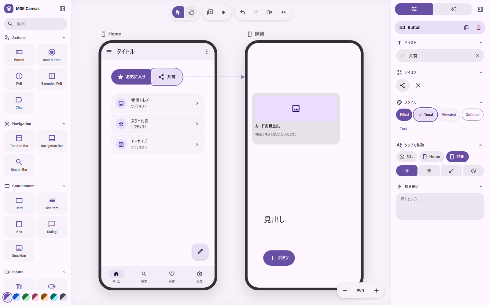<br><br>
      <b>🎨 Drag-and-Drop Canvas Editor</b><br>
      <sub>Multi-screen positioning, magnetic snapping, corner blending, and comprehensive component palette.</sub>
    </td>
    <td width="50%" align="center" valign="top">
      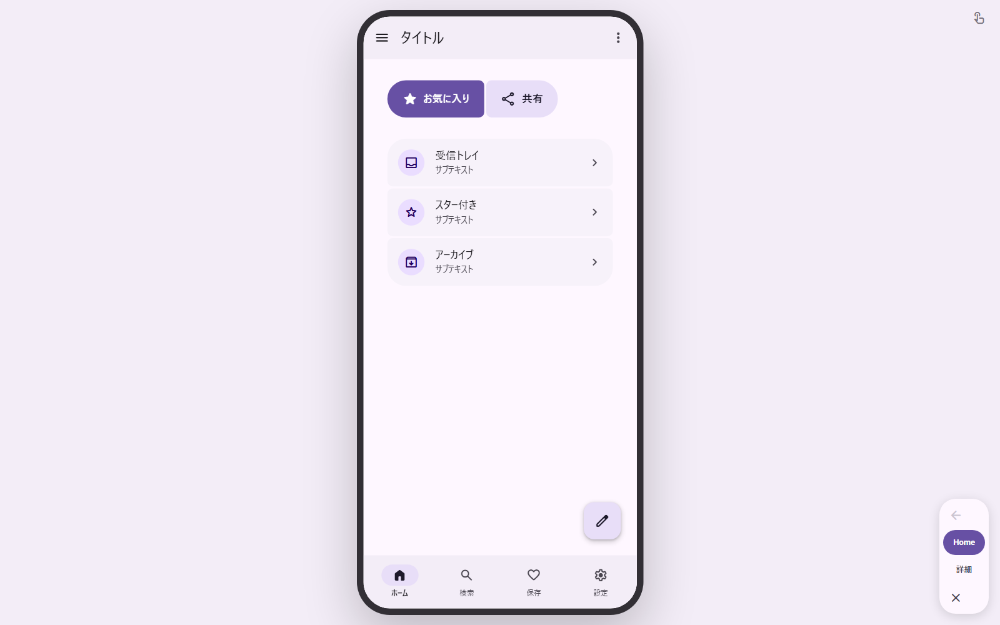<br><br>
      <b>⚡ Interactive Prototype Preview</b><br>
      <sub>Test real button clicks, state toggles, animated transitions, back-stack navigation, and gesture physics.</sub>
    </td>
  </tr>
  <tr>
    <td width="50%" align="center" valign="top">
      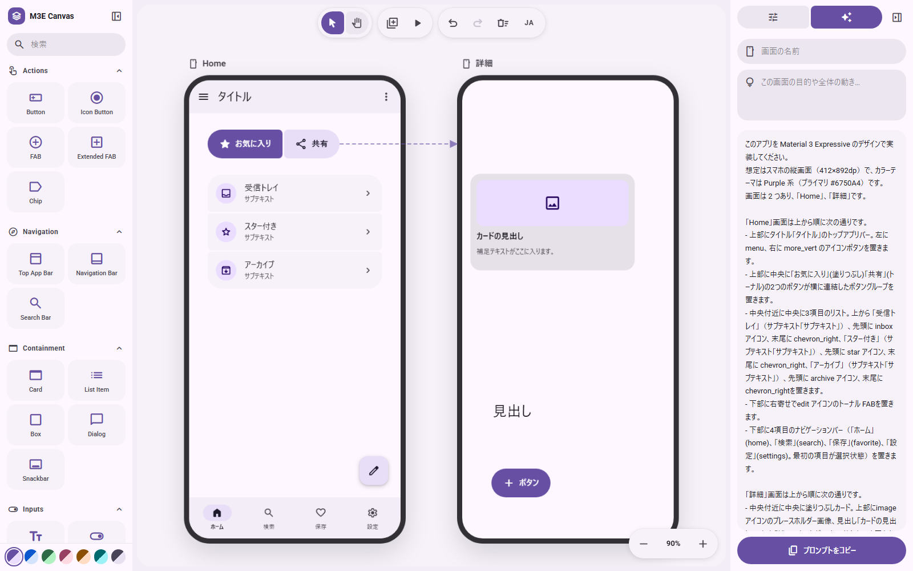<br><br>
      <b>🤖 AI Prompt Synthesis Engine</b><br>
      <sub>Export complete, production-ready specifications formatted for Claude Code, Cursor, Codex, and Gemini.</sub>
    </td>
    <td width="50%" align="center" valign="top">
      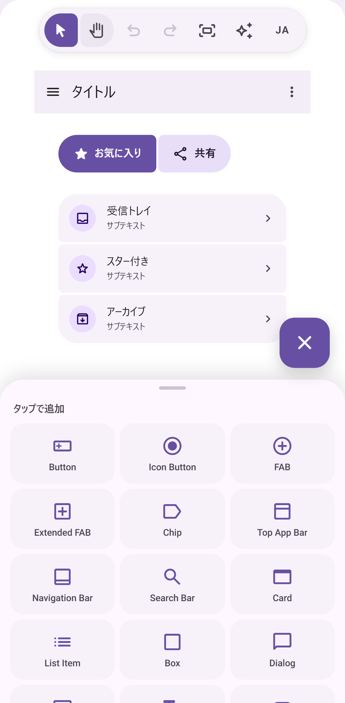<br><br>
      <b>📱 Mobile Companion Experience</b><br>
      <sub>Responsive mobile-friendly editor mode for tweaking colors, tokens, and components directly on smartphones.</sub>
    </td>
  </tr>
</table>

</div>

<h3 id="design"><picture><source media="(prefers-color-scheme: dark) and (max-width: 640px)" srcset="assets/readme/dark/hm-design.svg"><source media="(prefers-color-scheme: dark)" srcset="assets/readme/dark/h-design.svg"><source media="(max-width: 640px)" srcset="assets/readme/light/hm-design.svg">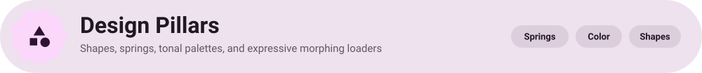</picture></h3>

Material 3 Expressive expands upon standard Material Design with tactile delight, fluid motion, and spatial intelligence:

* **Fluid Spring Physics**: Interfaces move with physics rather than fixed durations—bouncy tap feedback, elastic overshoots, and fluid drag-to-dismiss sheets.
* **Dynamic Tonal Harmonization**: Extract complete Primary, Secondary, Tertiary, Container, Surface, and Outline tonal roles algorithmically from single base colors or system wallpapers.
* **Organic Corner Blending**: Adjacent buttons and card tiles fuse seamlessly into unified visual clusters with soft corner radiuses.
* **Morphing Loaders**: Shape-shifting loading spinners and undulating progress bars ported directly from Android open-source components.

<h3 id="features"><picture><source media="(prefers-color-scheme: dark) and (max-width: 640px)" srcset="assets/readme/dark/hm-features.svg"><source media="(prefers-color-scheme: dark)" srcset="assets/readme/dark/h-features.svg"><source media="(max-width: 640px)" srcset="assets/readme/light/hm-features.svg">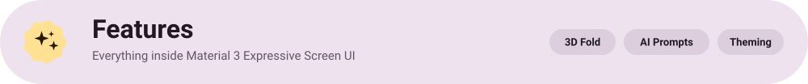</picture></h3>

<div align="center">

| | |
|:---:|:---:|
| <a href="#devices" title="Xiaomi 18 Fold 3D Simulation"><picture><source media="(prefers-color-scheme: dark)" srcset="assets/readme/dark/card-fold.svg">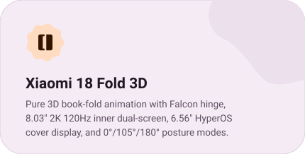</picture></a> | <a href="#prompt" title="AI Prompt Synthesis"><picture><source media="(prefers-color-scheme: dark)" srcset="assets/readme/dark/card-ai.svg">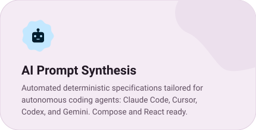</picture></a> |
| <a href="#design" title="Dynamic Color Engine"><picture><source media="(prefers-color-scheme: dark)" srcset="assets/readme/dark/card-theming.svg">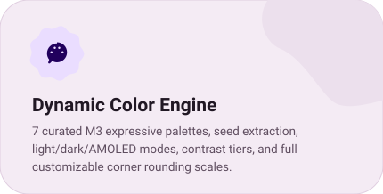</picture></a> | <a href="#features" title="Magnetic Docking & Tidy"><picture><source media="(prefers-color-scheme: dark)" srcset="assets/readme/dark/card-docking.svg">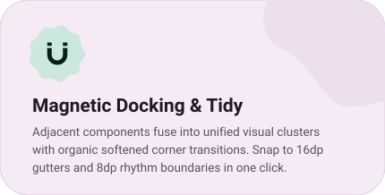</picture></a> |
| <a href="#design" title="Morphing Loaders"><picture><source media="(prefers-color-scheme: dark)" srcset="assets/readme/dark/card-loaders.svg">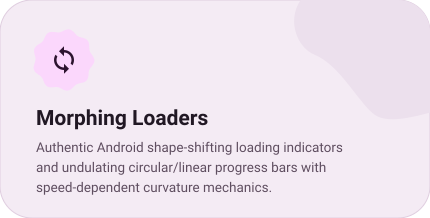</picture></a> | <a href="#screenshots" title="Interactive Wireframes"><picture><source media="(prefers-color-scheme: dark)" srcset="assets/readme/dark/card-prototype.svg">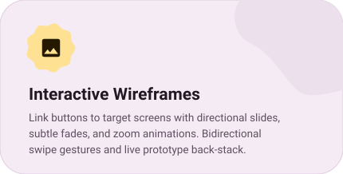</picture></a> |
| <a href="#faq" title="100% Client-Side Privacy"><picture><source media="(prefers-color-scheme: dark)" srcset="assets/readme/dark/card-privacy.svg">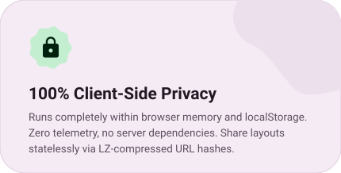</picture></a> | <a href="#devices" title="Multi-Device Ecosystem"><picture><source media="(prefers-color-scheme: dark)" srcset="assets/readme/dark/card-multidevice.svg">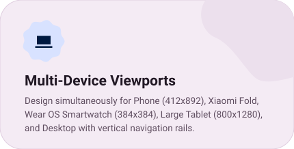</picture></a> |

</div>

<h3 id="prompt"><picture><source media="(prefers-color-scheme: dark) and (max-width: 640px)" srcset="assets/readme/dark/hm-prompt.svg"><source media="(prefers-color-scheme: dark)" srcset="assets/readme/dark/h-prompt.svg"><source media="(max-width: 640px)" srcset="assets/readme/light/hm-prompt.svg"></picture></h3>

The built-in prompt synthesizer transforms visual designs into structured specifications ready for autonomous AI coding agents:

```
[M3E CANVAS SPECIFICATION]
Viewport: Xiaomi 18 Fold (780 x 892 dp, Unfolded dual screen)
Posture: Flat (180deg)
Theme: Violet Expressive (Seed: #6750A4, Mode: Dark)
Layout Rhythm: 16dp outer gutters, 8dp intra-component spacing

COMPONENTS HIERARCHY:
1. TopAppBar (CenterAligned, title: "Explore Kitchen", actions: [Search, FilterChips])
2. HeroFoldableContainer (Dual pane split: left=RecipeImage, right=IngredientList)
3. BottomAppBar (Floating pill, items: [Home, Cook, Profile], fab: SplitActionButton)
```

1. **Claude Code / Anthropic**: Paste directly into terminal sessions to generate complete Jetpack Compose or Next.js code.
2. **Cursor & Windsurf**: Feed into composer mode to create clean, responsive components without hallucinating layout coordinates.
3. **OpenAI ChatGPT & Codex**: Transform screens into modern Tailwind CSS + React 19 JSX trees.
4. **Google Gemini CLI**: Execute component updates and theme tests with Gemini 2.5 Flash / Pro models.

<h3 id="stack"><picture><source media="(prefers-color-scheme: dark) and (max-width: 640px)" srcset="assets/readme/dark/hm-stack.svg"><source media="(prefers-color-scheme: dark)" srcset="assets/readme/dark/h-stack.svg"><source media="(max-width: 640px)" srcset="assets/readme/light/hm-stack.svg"></picture></h3>

<div align="center">

<a href="https://nextjs.org" target="_blank" rel="noopener noreferrer" title="Next.js 16 App Router"><picture><source media="(prefers-color-scheme: dark)" srcset="assets/readme/dark/pill-nextjs.svg"></picture></a>
<a href="https://react.dev" target="_blank" rel="noopener noreferrer" title="React 19 Declarative UI"><picture><source media="(prefers-color-scheme: dark)" srcset="assets/readme/dark/pill-react.svg"></picture></a>
<a href="https://www.typescriptlang.org" target="_blank" rel="noopener noreferrer" title="TypeScript 5.7 Static Typing"><picture><source media="(prefers-color-scheme: dark)" srcset="assets/readme/dark/pill-ts.svg"></picture></a>
<a href="https://m3.material.io" target="_blank" rel="noopener noreferrer" title="Google Material 3 Expressive"><picture><source media="(prefers-color-scheme: dark)" srcset="assets/readme/dark/pill-m3e.svg"></picture></a>
<br><br>
<a href="https://motion.dev" target="_blank" rel="noopener noreferrer" title="Framer Motion 12 Spring Physics"><picture><source media="(prefers-color-scheme: dark)" srcset="assets/readme/dark/pill-motion.svg"></picture></a>
<a href="https://tailwindcss.com" target="_blank" rel="noopener noreferrer" title="Tailwind CSS 3.4 Utility Framework"><picture><source media="(prefers-color-scheme: dark)" srcset="assets/readme/dark/pill-tailwind.svg"></picture></a>
<a href="https://fonts.google.com/icons" target="_blank" rel="noopener noreferrer" title="Google Material Symbols"><picture><source media="(prefers-color-scheme: dark)" srcset="assets/readme/dark/pill-symbols.svg"></picture></a>
<a href="https://vitest.dev" target="_blank" rel="noopener noreferrer" title="Vitest 3 Unit Testing"><picture><source media="(prefers-color-scheme: dark)" srcset="assets/readme/dark/pill-vitest.svg"></picture></a>
<a href="#faq" title="HTML5 LocalStorage Client Persistence"><picture><source media="(prefers-color-scheme: dark)" srcset="assets/readme/dark/pill-storage.svg"></picture></a>

</div>

<br>

<table width="100%"><thead><tr><th align="left" width="22%">Layer</th><th align="left" width="38%">Technology</th><th align="left">Purpose & Role</th></tr></thead><tbody>
<tr><td><b>Framework</b></td><td>Next.js 16 (App Router)</td><td>Modern server/client architecture with static HTML compilation for GitHub Pages.</td></tr>
<tr><td><b>UI Library</b></td><td>React 19</td><td>Declarative visual components, optimistic actions, and high-performance render cycles.</td></tr>
<tr><td><b>Language</b></td><td>TypeScript 5.7</td><td>Strict static typing across canvas primitives, theme tokens, and component definitions.</td></tr>
<tr><td><b>Motion Engine</b></td><td>Framer Motion 12</td><td>Physics-based spring simulations, gesture drag, layout animations, and 3D folding transforms.</td></tr>
<tr><td><b>Styling</b></td><td>Tailwind CSS 3.4</td><td>Utility-first responsive styles coupled with M3 dynamic CSS custom variables.</td></tr>
<tr><td><b>Icons</b></td><td>Google Material Symbols & Lucide React</td><td>Complete M3 icon catalog with round, sharp, and outlined stylistic variations.</td></tr>
<tr><td><b>Storage</b></td><td>HTML5 LocalStorage + LZ-String</td><td>100% offline client persistence and stateless compressed URL hash sharing.</td></tr>
<tr><td><b>Test Runner</b></td><td>Vitest 3 + Testing Library</td><td>Fast reactive unit testing with 750+ passing automated tests.</td></tr>
</tbody></table>

<h3 id="start"><picture><source media="(prefers-color-scheme: dark) and (max-width: 640px)" srcset="assets/readme/dark/hm-start.svg"><source media="(prefers-color-scheme: dark)" srcset="assets/readme/dark/h-start.svg"><source media="(max-width: 640px)" srcset="assets/readme/light/hm-start.svg">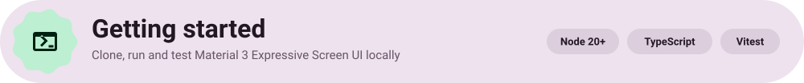</picture></h3>

**Requirements**

| Requirement | Supported Version |
|:---|:---|
| **Node.js** | v20.x or newer |
| **Package Manager** | `npm` (v10+), `pnpm`, or `bun` |
| **Browser** | Chrome, Edge, Safari, or Firefox (latest) |

**Build & Run**

```bash
# 1. Clone the repository
git clone https://github.com/smartworldarafath/Material-3-Expressive-Screen-UI.git
cd Material-3-Expressive-Screen-UI

# 2. Install dependencies
npm install

# 3. Start local development server
npm run dev        # Visit http://localhost:3000

# 4. Run TypeScript check and unit tests
npm run typecheck
npm test

# 5. Compile static production export
npm run build      # Static export written to ./out
```

<table width="100%"><thead><tr><th align="left" width="28%">Shortcut</th><th align="left">Functionality</th></tr></thead><tbody>
<tr><td><code>V</code> / <code>H</code></td><td>Toggle Pointer select mode / Hand pan mode (or hold <code>Space</code> to pan canvas)</td></tr>
<tr><td><code>Mouse Wheel</code> / <code>Ctrl + Wheel</code></td><td>Pan canvas vertically / Smoothly zoom in and out</td></tr>
<tr><td><code>+</code> / <code>-</code> / <code>0</code></td><td>Zoom in, Zoom out, or Fit entire canvas to viewport</td></tr>
<tr><td><code>Ctrl + Z</code> / <code>Ctrl + Shift + Z</code></td><td>Undo last canvas edit / Redo previously reverted change</td></tr>
<tr><td><code>Ctrl + D</code></td><td>Duplicate selected component or entire screen</td></tr>
<tr><td><code>Arrow Keys</code> (<code>Shift</code> = 10px)</td><td>Nudge selected component precisely along 1px or 10px increments</td></tr>
<tr><td><code>Delete</code> / <code>Backspace</code></td><td>Remove active selection or delete screen</td></tr>
<tr><td><code>P</code></td><td>Launch interactive prototype preview simulation</td></tr>
</tbody></table>

<h3 id="faq"><picture><source media="(prefers-color-scheme: dark) and (max-width: 640px)" srcset="assets/readme/dark/hm-faq.svg"><source media="(prefers-color-scheme: dark)" srcset="assets/readme/dark/h-faq.svg"><source media="(max-width: 640px)" srcset="assets/readme/light/hm-faq.svg">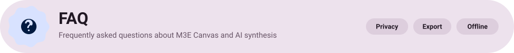</picture></h3>

**Is my design data private?**  
Yes, 100%. The application is completely browser-resident. All canvas documents and custom schemes live solely inside your browser's local storage. No data is ever sent to an external server.

**How does the Xiaomi 18 Fold 3D simulation work?**  
It renders a physically proportioned foldable device with pure 3D CSS perspective. Clicking **3D Fold** or choosing **Flat (180°)** or **Flex (105°)** posture folds the Falcon hinge realistically while keeping all canvas components fully responsive.

**How do I pass prompts to AI programming agents?**  
Click the **Prompt** button in the top toolbar, select your target framework (Android Jetpack Compose, Web React/Tailwind, or Flutter), copy the synthesized prompt, and paste it into Claude Code, Cursor, Codex, or Gemini CLI.

**Can I use it offline?**  
Yes. Since there are zero backend server dependencies, you can install it as a PWA or run `npm run dev` / `npm run build` locally completely offline.

<h3 id="support"><picture><source media="(prefers-color-scheme: dark) and (max-width: 640px)" srcset="assets/readme/dark/hm-support.svg"><source media="(prefers-color-scheme: dark)" srcset="assets/readme/dark/h-support.svg"><source media="(max-width: 640px)" srcset="assets/readme/light/hm-support.svg"></picture></h3>

Material 3 Expressive Screen UI is 100% free, ad-free, and open source under the MIT License. If it elevates your design workflow or saves you hours of UI engineering, please consider supporting ongoing maintenance and new features:

<div align="center">

<table>
  <tr>
    <td align="center" width="25%" valign="top">
      <h4> SupportKori</h4>
      <a href="https://www.supportkori.com/arafathrahman" target="_blank">
        
      </a><br/><br/>
      <a href="https://www.supportkori.com/arafathrahman" target="_blank">
        
      </a><br/>
      <sub>Cards · bKash · Nagad · Global</sub>
    </td>
    <td align="center" width="25%" valign="top">
      <h4> nsave</h4>
      <br/><br/>
      <br/>
      <sub>Ntag: <code>@arafath_rahman9</code></sub>
    </td>
    <td align="center" width="25%" valign="top">
      <h4> RedotPay</h4>
      <br/><br/>
      <br/>
      <sub>ID: <code>1965421414</code></sub>
    </td>
    <td align="center" width="25%" valign="top">
      <h4> Payoneer</h4>
      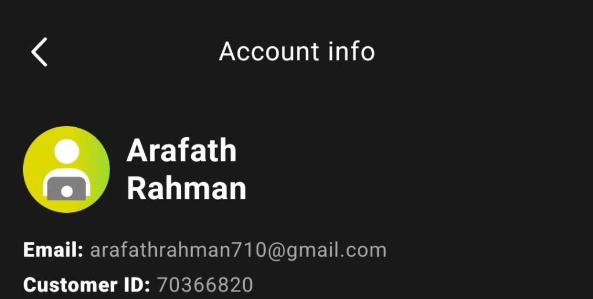<br/><br/>
      <a href="mailto:arafathrahman710@gmail.com?subject=Support%20via%20Payoneer">
        
      </a><br/>
      <sub>Email: <code>arafathrahman710@gmail.com</code></sub>
    </td>
  </tr>
</table>

<br>

| Method | Details & Direct Links |
| :--- | :--- |
| ** SupportKori** | [supportkori.com/arafathrahman](https://www.supportkori.com/arafathrahman) (bKash, Nagad, Visa, Mastercard) |
| **💖 GitHub Sponsors** | [github.com/sponsors/smartworldarafath](https://github.com/sponsors/smartworldarafath) |
| ** nsave** | Ntag: `@arafath_rahman9` · Account: `Md Arafath Rahman` |
| ** RedotPay** | Account ID: `1965421414` |
| ** Payoneer** | Email: `arafathrahman710@gmail.com` · Customer ID: `70366820` |

</div>

<div align="center">

<a href="https://github.com/smartworldarafath">
  
</a>

#### **Arafath Rahman** ([@smartworldarafath](https://github.com/smartworldarafath))
*Maintainer & Lead Developer · Open Source Creator*

</div>

<div align="center">

<table>
  <tr>
    <td align="center" width="16%">
      <a href="https://github.com/smartworldarafath">
        <br />
        <sub><b>Arafath Rahman</b></sub>
      </a><br />
      <sub>Maintainer & Lead</sub>
    </td>
    <td align="center" width="16%">
      <a href="https://github.com/lnkiai">
        <br />
        <sub><b>lnkiai</b></sub>
      </a><br />
      <sub>Contributor</sub>
    </td>
    <td align="center" width="16%">
      <a href="https://github.com/rishabhiskawai">
        <br />
        <sub><b>rishabhiskawai</b></sub>
      </a><br />
      <sub>Contributor</sub>
    </td>
    <td align="center" width="16%">
      <a href="https://github.com/jungminjo">
        <br />
        <sub><b>jungminjo</b></sub>
      </a><br />
      <sub>Contributor</sub>
    </td>
    <td align="center" width="16%">
      <a href="https://github.com/CQMHV">
        <br />
        <sub><b>CQMHV</b></sub>
      </a><br />
      <sub>Contributor</sub>
    </td>
    <td align="center" width="16%">
      <a href="https://github.com/Cokedog320">
        <br />
        <sub><b>Cokedog320</b></sub>
      </a><br />
      <sub>Contributor</sub>
    </td>
  </tr>
</table>

</div>

<h3 id="license"><picture><source media="(prefers-color-scheme: dark) and (max-width: 640px)" srcset="assets/readme/dark/hm-license.svg"><source media="(prefers-color-scheme: dark)" srcset="assets/readme/dark/h-license.svg"><source media="(max-width: 640px)" srcset="assets/readme/light/hm-license.svg"></picture></h3>

Material 3 Expressive Screen UI is licensed under the **[MIT License](LICENSE)** © 2026 Arafath Rahman and Contributors.

* **Expressive Loading Indicators**: Ported from [material-components-android](https://github.com/material-components/material-components-android) based on [Aler1x/m3-loading-indicator](https://github.com/Aler1x/m3-loading-indicator) (Apache-2.0).
* **System Icons**: [Material Symbols](https://fonts.google.com/icons) and [Lucide Icons](https://lucide.dev/).
* **Related Inspirations**: [matraic/m3e](https://github.com/matraic/m3e) and [Beer CSS](https://www.beercss.com/).

<div align="center">
<sub>Search terms: Material 3 Expressive, M3E, Android UI builder, Jetpack Compose UI generator, AI prompt generator for UI, Xiaomi 18 Fold simulation, 3D foldable screen, Wear OS canvas, design system canvas, Claude Code prompt builder, Cursor UI designer, Pixel style design.</sub>
</div>
